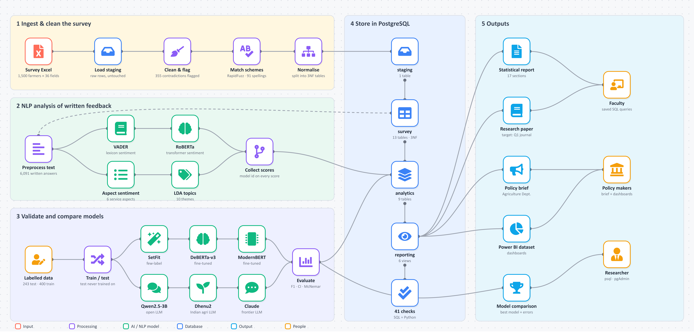

# Policy Intelligence for Agriculture

A PostgreSQL database and NLP system for farmer feedback on government welfare schemes — Chittoor district, Andhra Pradesh (N = 1,500).

**Krish Singh** (24BDS0235), Vellore Institute of Technology — under the guidance of **Prof. Sangeetha S**.
Database Systems Lab project; the findings are being prepared as a research paper targeting a Q1 journal.

The survey dataset was verified by the Ethnic Community, Government of Andhra Pradesh.

| Document | Link |
|---|---|
| Complete project report (PDF) | [docs/Complete_Project_Report.pdf](docs/Complete_Project_Report.pdf) |
| Project presentation & demonstration | [docs/Project_Demonstration.pptx](docs/Project_Demonstration.pptx) |
| Model comparison results | [results/](results/) |



## Results at a glance

Sentiment models scored on 243 human-labelled test answers (never used for training):

| Model | Type | Accuracy | Macro-F1 |
|---|---|---|---|
| **Fine-tuned ModernBERT-base** | fine-tuned encoder (5 seeds) | 0.835 | **0.765** |
| Claude Opus 5.5 | LLM, zero-shot | 0.786 | 0.742 |
| Dhenu2 (KissanAI, Indian agriculture) | LLM, 3-shot, 4-bit | 0.749 | 0.704 |
| SetFit (all-mpnet-base-v2) | few-label (5 seeds) | 0.840 | 0.675 |
| TF-IDF logistic regression | trained baseline | 0.745 | 0.641 |
| Fine-tuned DeBERTa-v3-base | fine-tuned encoder (5 seeds) | 0.749 | 0.533 |
| Dhenu2 | LLM, zero-shot | 0.519 | 0.445 |
| RoBERTa (Twitter) | pretrained, zero-shot | 0.506 | 0.439 |
| Qwen2.5-3B-Instruct | LLM, 3-shot, 4-bit | 0.457 | 0.391 |
| Qwen2.5-3B-Instruct | LLM, zero-shot | 0.300 | 0.321 |
| VADER + agriculture lexicon | lexicon | 0.235 | 0.223 |

ModernBERT's lead over Claude and SetFit is not statistically significant (exact McNemar test); it is significantly better than all other models. The agriculture-specific Dhenu2 clearly outperforms a general LLM of the same size. Full results: [results/](results/).

**Data availability:** the raw survey, the labelling worksheets and per-farmer outputs contain personal details and are not included in this repository. The code rebuilds every output from the original file.

## Folder structure

```
data/        Research_farmers_dataset.xlsx — raw survey, never modified
db/          schema.sql (22 tables + staging + views), queries.sql (analysis queries), .env (local connection settings)
src/         reusable modules (cleaning, sentiment, ABSA, topics, statistics, evaluation, report helpers)
scripts/     numbered pipeline, run in order
output/      everything the scripts generate
reports/     research paper, statistical report, policy brief, Review 1 deck
extra/       supporting material outside the main pipeline (viva notes, early pilot files, superseded scripts)
```

## Setup

```
python -m venv venv
venv\Scripts\activate
pip install -r requirements.txt
```

PostgreSQL 16 runs locally (service `postgresql-x64-16`, port 5432). Connection settings are in `db/.env`; the database `farmer_policy` is created by script 07. To browse it, open pgAdmin 4 → Servers → PostgreSQL 16 → user `postgres`, with the password from `db/.env`.

## Run order

| Step | Script | Produces |
|---|---|---|
| 1 | `scripts/01_run_pipeline.py` | `output/sentiment_analysis_results.xlsx` (master, one row per farmer), `divergence_summary.csv`, `sentiment_distribution.csv`, `scheme_name_normalization_counts.csv` |
| 2 | `scripts/02_run_analysis.py` | `data_quality_numeric_issues.csv`, `data_quality_logic_issues.csv`, `statistical_tests_chisquare.csv`, `statistical_tests_correlations.csv`, `statistical_tests_agreement.csv`, `topic_modeling_results.xlsx` |
| 3 | `scripts/03_build_powerbi_dataset.py` | `PowerBI_Dataset.xlsx` (Fact_Responses, Fact_Aspect) |
| 4 | `scripts/04_build_annotation_worksheets.py` | `Annotation_Worksheet.xlsx`, `ABSA_Annotation_Worksheet.xlsx` (refuses to overwrite sheets that already have labels) |
| 5 | `scripts/05_evaluate_models.py` | `validation_results.xlsx` (after annotation) |
| 6 | `scripts/06_descriptive_statistics.py` | `descriptive_statistics.xlsx`, `report_numbers.json` |
| 7 | `scripts/07_load_database.py` | PostgreSQL database `farmer_policy`, `database_verification.csv` |
| 8 | `scripts/08_build_statistical_report.py` | `reports/Full_Statistical_Analysis.docx` |
| 9 | `scripts/09_build_research_paper.py` | `reports/Policy_Intelligence_Research_Paper.docx` |
| 10 | `scripts/10_build_policy_brief.py` | `reports/Policy_Intelligence_Brief.md` |

Step 1 downloads the RoBERTa model (~500 MB) on first run; `--skip-transformer` runs it without.
Step 7 rebuilds the database from scratch each time and checks that the SQL views reproduce the Python results (sentiment counts, divergence rates, scheme figures, awareness counts); it stops with an error if any check fails.

## After the annotation worksheets are filled

Save both worksheets in place, then run:

```
python scripts/05_evaluate_models.py
python scripts/06_descriptive_statistics.py
python scripts/07_load_database.py
python scripts/08_build_statistical_report.py
python scripts/09_build_research_paper.py
python scripts/10_build_policy_brief.py
```

Files that change:

| File | Change |
|---|---|
| `output/validation_results.xlsx` | created: accuracy, macro-precision/recall/F1, kappa with 95% bootstrap CIs; per-class results; confusion matrices; aspect detection and polarity |
| `output/report_numbers.json` | gains the validation results |
| PostgreSQL `analytics.annotator`, `analytics.annotation` | filled; view `reporting.v_validation_metrics` returns accuracy per model |
| `output/database_verification.csv` | re-checked |
| `reports/Full_Statistical_Analysis.docx` | Section 17 (model validation) filled in |
| `reports/Policy_Intelligence_Research_Paper.docx` | abstract, Section 4.10 (validation results with tables), discussion, limitations and conclusion updated |
| `reports/Policy_Intelligence_Brief.md` | validation limitation updated |

Nothing else changes: the master results, topic models, statistical tests, Power BI dataset and the worksheets themselves stay as they are.
If a worksheet's text no longer matches the master file, step 5 stops instead of evaluating against the wrong rows.

## Model comparison (research extension)

The farmers' answers were given mostly in Telugu (1,331 of 1,500 interviews) but recorded in English by the interviewers, so English models are used throughout.

| Step | Script | Produces |
|---|---|---|
| 11 | `scripts/11_build_training_worksheets.py` | `Annotation_Worksheet_rater2.xlsx` (same 243 rows, blank, for a second annotator), `Training_Worksheet.xlsx` (400 rows, disjoint from the test set), `training_batch_selection.csv` |
| 12 | `scripts/12_compare_models.py` | `model_comparison_results.xlsx` |

Design:

- **Test set** = `Annotation_Worksheet.xlsx` (stratified random 20% sample). It is never used for training or prompt examples.
- **Training set** = `Training_Worksheet.xlsx`: 200 rows the zero-shot models are least sure about (RoBERTa entropy plus VADER/RoBERTa disagreement, spread across 20 TF-IDF clusters) and 200 stratified random rows. Do not open `training_batch_selection.csv` before labelling.
- **AI-assisted training labels (disclosed)**: `Training_Worksheet.xlsx` has a locked `AI_Suggestion` column (pre-labels by Claude, Anthropic; provenance in `output/training_ai_suggestions.csv`). The annotator verifies or corrects every row in `Label`, and script 12 reports how many suggestions were changed. The test, ABSA and rater-2 sheets carry no AI suggestions.
- **Models**: VADER and RoBERTa (zero-shot baselines), TF-IDF logistic regression, SetFit (`all-mpnet-base-v2`), fine-tuned DeBERTa-v3-base, and optional LLMs (`--llm <model id>`, zero-shot and few-shot; few-shot examples come from the training set only).
- **Reporting**: accuracy, macro-F1 with 95% bootstrap CI, mean ± SD over 5 seeds, exact McNemar test against the best model, per-class results, confusion matrices, learning curve (25–100% of training data), error analysis, inter-annotator kappa (when the rater-2 sheet is filled), and aspect-level comparison of the keyword ABSA against `yangheng/deberta-v3-base-absa-v1.1`.

Run after labelling `Annotation_Worksheet.xlsx` and `Training_Worksheet.xlsx`:

```
python scripts/12_compare_models.py
```

On a CPU the default run (5 seeds of SetFit and DeBERTa) takes roughly an hour. LLMs need a GPU — use `notebooks/colab_model_comparison.ipynb` on free Google Colab (T4), which runs:

```
python scripts/12_compare_models.py --llm Qwen/Qwen2.5-7B-Instruct --llm KissanAI/Dhenu2-In-Llama3.2-3B-Instruct --llm-4bit
```

Never label any worksheet with model or AI help — the human labels are the ground truth every model is scored against.
